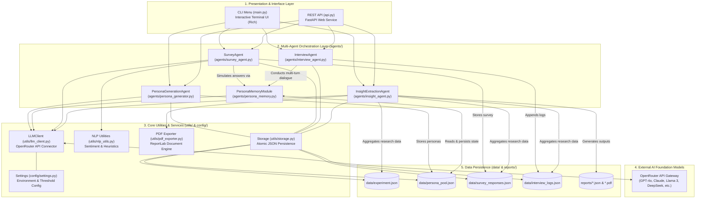

# System Architecture & Technical Documentation

This document provides a concise overview of the **Universal Synthetic User Research Platform** architecture, the technologies used, and the purpose of every code file across the repository.

---

## 1. System Architecture Overview

The platform uses a **modular, multi-tier agent-based architecture** designed to simulate human user research workflows (persona generation, surveys, 1-on-1 interviews, and insight synthesis) for any product domain without requiring real human participants.

### Core Architecture Flow
1. **Experiment Setup**: The user specifies the product name, domain, value proposition, target audience, and research objectives.
2. **Persona Synthesis**: `PersonaGenerationAgent` sends experiment specs to the LLM to generate diverse user archetypes with demographic, psychological, and behavioral traits.
3. **Cross-Persona Surveying**: `SurveyAgent` poses questions to all personas simultaneously. Each persona answers in-character through `PersonaMemoryModule`, which classifies sentiments.
4. **Interactive Qualitative Interview**: `InterviewAgent` lets researchers chat 1-on-1 with any persona while preserving conversation history and opinions.
5. **Insight Extraction & Reporting**: `InsightExtractionAgent` aggregates survey and interview data, identifies behavioral patterns, and exports structured JSON and PDF reports.

---

## 2. Technologies Used

| Technology / Library | Version | Purpose in Project |
| :--- | :--- | :--- |
| **Python** | 3.10+ | Core programming language powering the entire backend, CLI, and agents. |
| **FastAPI** | 0.110.0 | High-performance REST API backend providing endpoints for external UI/web integrations. |
| **Uvicorn** | 0.28.0 | ASGI web server running the FastAPI application. |
| **Rich** | 13.7.1 | Terminal styling, formatted tables, colored panels, and interactive prompts in the CLI. |
| **ReportLab** | 4.2.0 | Programmatic PDF document generation for research and executive reports. |
| **OpenRouter API** | REST API | Multi-model LLM provider allowing dynamic model switching (GPT-4o, Claude 3.5, Llama 3.3, etc.). |
| **Requests / HTTPX** | 2.31 / 0.27 | HTTP clients handling communication with OpenRouter chat completion endpoints. |
| **Pydantic** | 2.x | Data validation and schema enforcement for API requests and payloads. |
| **python-dotenv** | 1.0.1 | Environment configuration management loading API keys and settings from `.env`. |

---

## 3. Project Files & Their Purpose

### Entrypoints & Interface Layer
* **[`main.py`](file:///d:/PROJECTS/SyntheticUsersReserch/main.py)**:
  Interactive CLI application. Provides a 6-option menu to configure experiments, generate personas, launch surveys, conduct live interviews, and export reports with rich terminal styling.
* **[`api.py`](file:///d:/PROJECTS/SyntheticUsersReserch/api.py)**:
  FastAPI server exposing REST endpoints (`/api/setup-experiment`, `/api/generate-personas`, `/api/run-survey`, `/api/interview`, `/api/generate-report`, `/api/llm-config`).
* **[`test_pipeline.py`](file:///d:/PROJECTS/SyntheticUsersReserch/test_pipeline.py)**:
  End-to-end automated verification script that executes the complete research workflow across multiple test product domains.

### Configuration Layer
* **[`config/settings.py`](file:///d:/PROJECTS/SyntheticUsersReserch/config/settings.py)**:
  Central configuration module. Reads `.env` values (`OPENROUTER_API_KEY`, `OPENROUTER_MODEL`, `OPENROUTER_BASE_URL`), sets thresholds (sentiment thresholds, memory window), and provides status checks.
* **[`.env`](file:///d:/PROJECTS/SyntheticUsersReserch/.env)** & **[`.env.example`](file:///d:/PROJECTS/SyntheticUsersReserch/.env.example)**:
  Environment variable definition files storing API credentials and active LLM model selection.

### Agent Layer (`agents/`)
* **[`agents/persona_generator.py`](file:///d:/PROJECTS/SyntheticUsersReserch/agents/persona_generator.py)**:
  `PersonaGenerationAgent` dynamically generates diverse, domain-tailored synthetic user profiles (archetype, demographics, habits, pain points, willingness to pay, churn triggers, and psychological traits). Includes deterministic fallback archetypes.
* **[`agents/persona_memory.py`](file:///d:/PROJECTS/SyntheticUsersReserch/agents/persona_memory.py)**:
  `PersonaMemoryModule` maintains cognitive consistency for each persona. Tracks conversation history, locks established opinions across turns, and generates in-character responses using LLM system prompts.
* **[`agents/survey_agent.py`](file:///d:/PROJECTS/SyntheticUsersReserch/agents/survey_agent.py)**:
  `SurveyAgent` suggests product-specific survey questions using LLM intelligence and runs batch surveys across all personas in parallel, extracting key takeaways and sentiment labels.
* **[`agents/interview_agent.py`](file:///d:/PROJECTS/SyntheticUsersReserch/agents/interview_agent.py)**:
  `InterviewAgent` manages interactive 1-on-1 interview sessions with individual personas, persisting multi-turn dialogue to `interview_logs.json`.
* **[`agents/insight_agent.py`](file:///d:/PROJECTS/SyntheticUsersReserch/agents/insight_agent.py)**:
  `InsightExtractionAgent` performs qualitative data synthesis across surveys and interviews. Identifies cross-cutting themes, behavioral segments, friction points, and recommendations, triggering both JSON and PDF export.

### Utilities Layer (`utils/`)
* **[`utils/llm_client.py`](file:///d:/PROJECTS/SyntheticUsersReserch/utils/llm_client.py)**:
  `LLMClient` wraps OpenRouter's HTTP chat completions API. Handles bearer authentication, prompt payloads, response retries, JSON markdown sanitization, and configuration validation.
* **[`utils/nlp_utils.py`](file:///d:/PROJECTS/SyntheticUsersReserch/utils/nlp_utils.py)**:
  Provides text processing utilities and heuristic keyword/lexicon sentiment analysis used when scoring responses or running without LLM dependencies.
* **[`utils/pdf_exporter.py`](file:///d:/PROJECTS/SyntheticUsersReserch/utils/pdf_exporter.py)**:
  Builds styled, multi-page PDF research reports using ReportLab with custom color palettes, tables, callout blocks, and executive summaries.
* **[`utils/storage.py`](file:///d:/PROJECTS/SyntheticUsersReserch/utils/storage.py)**:
  Atomic file operations (`load_json`, `save_json`) ensuring safe reading and writing of data files.

### Persistence Layer (`data/` and `reports/`)
* **`data/experiment.json`**: Active experiment metadata (product name, description, target audience, objectives).
* **`data/persona_pool.json`**: Generated persona profiles with memory state and opinion records.
* **`data/survey_responses.json`**: Aggregated survey questions, persona answers, and sentiment tags.
* **`data/interview_logs.json`**: Conversation turn records between human researchers and synthetic personas.
* **`reports/`**: Destination directory for generated timestamped research reports (`report_<timestamp>.json` and `report_<timestamp>.pdf`).
