# System Architecture & Technical Documentation

This document provides a comprehensive overview of the **Universal Synthetic User Research Platform** (SynthaResearch) architecture, the technologies used, and the purpose of every code module across the repository.

---

## 1. System Architecture Overview

The platform uses a **modular, multi-tier agent-based and micro-service architecture** designed to simulate human user research workflows (persona generation, surveys, 1-on-1 qualitative interviews, and insight synthesis) for any product domain without requiring real human participants.

The system supports both an **interactive terminal CLI** for quick local workflows and a full **production-grade web application** featuring a Next.js frontend, FastAPI backend, MongoDB Beanie ODM persistence, and secure JWT authentication.

```mermaid
flowchart TD
    subgraph UI_Layer ["1. Presentation & Interface Layer"]
        CLI["CLI Menu (main.py)<br/>Interactive Terminal UI (Rich)"]
        WEB["Next.js 16 Web App (client/)<br/>React 19 + TypeScript + Tailwind CSS"]
        API["FastAPI REST API (api.py)<br/>Uvicorn ASGI + CORS"]
    end

    subgraph Auth_Security ["2. Authentication & Access Layer (auth/)"]
        JWT["JWT Security (auth/utils.py)<br/>Access & Refresh Tokens"]
        AUTHR["Auth Router (auth/router.py)<br/>Register, Login, Me, Profile, Refresh"]
        DEP["Dependencies (auth/dependencies.py)<br/>Bearer Token & Cookie Extraction"]
    end

    subgraph Router_Layer ["3. Modular API Routers (routers/)"]
        SYS_R["system_router (routers/system.py)<br/>Health & LLM Config"]
        EXP_R["experiments_router (routers/experiments.py)<br/>Product Workspace & Activation"]
        PER_R["personas_router (routers/personas.py)<br/>Cohort Generation & Roster"]
        SUR_R["surveys_router (routers/surveys.py)<br/>AI Questions & Survey Matrix"]
        INT_R["interviews_router (routers/interviews.py)<br/>1-on-1 Sessions & Turns"]
        REP_R["reports_router (routers/reports.py)<br/>Adoption Score, PDF & Insights"]
    end

    subgraph Agent_Layer ["4. Multi-Agent Orchestration Layer (agents/ & services.py)"]
        PGA["PersonaGenerationAgent<br/>(agents/persona_generator.py)"]
        PMM["PersonaMemoryModule<br/>(agents/persona_memory.py)"]
        SA["SurveyAgent<br/>(agents/survey_agent.py)"]
        IA["InterviewAgent<br/>(agents/interview_agent.py)"]
        IEA["InsightExtractionAgent<br/>(agents/insight_agent.py)"]
    end

    subgraph Utilities_Layer ["5. Core Utilities, Normalization & Config"]
        LLM["LLMClient (utils/llm_client.py)<br/>OpenRouter Multi-Model Gateway"]
        NORM["Normalizer (utils/normalizer.py)<br/>Domain Profiling & Heuristics"]
        CFG["Settings (config/settings.py)<br/>Environment, DB & Thresholds"]
        NLP["NLP Utilities (utils/nlp_utils.py)<br/>Sentiment & Lexicon Scoring"]
        PDF["PDF Exporter (utils/pdf_exporter.py)<br/>ReportLab Document Generator"]
        BANK["Templates & Banks (templates/)<br/>Demographic Names & Responses"]
        STG["Storage (utils/storage.py)<br/>Atomic JSON Persistence"]
    end

    subgraph Persistence_Layer ["6. Database & Persistence Layer"]
        subgraph Mongo_DB ["MongoDB + Beanie ODM (db/)"]
            M_USER[("users")]
            M_EXP[("experiments")]
            M_PER[("personas")]
            M_SURV[("survey_sessions")]
            M_INT[("interview_sessions")]
            M_REP[("reports")]
        end
        subgraph Local_Files ["Local Artifacts & File Fallbacks"]
            FS_REP[("reports/*.pdf & *.json")]
            FS_DATA[("data/*.json (CLI / Local)")]
        end
    end

    subgraph External_Service ["7. Foundation AI Models"]
        OR["OpenRouter API Gateway<br/>(Claude 3.5 Sonnet, GPT-4o, Llama 3.3, Gemini 2.5, DeepSeek)"]
    end

    %% Client/API Connections
    WEB <-->|REST API + Bearer / Cookies| API
    CLI --> PGA & SA & IA & IEA
    API --> AUTHR
    API --> SYS_R & EXP_R & PER_R & SUR_R & INT_R & REP_R
    AUTHR & EXP_R & PER_R & SUR_R & INT_R & REP_R --> DEP
    DEP --> JWT

    %% Routers to DB
    AUTHR <--> M_USER
    EXP_R <--> M_EXP
    PER_R <--> M_PER
    SUR_R <--> M_SURV
    INT_R <--> M_INT
    REP_R <--> M_REP

    %% Routers to Agents
    EXP_R --> NORM
    PER_R --> PGA
    SUR_R --> SA
    INT_R --> PMM
    REP_R --> IEA & PDF
    PDF --> FS_REP

    %% Agents internal flows
    PGA --> BANK & LLM
    SA --> PMM & LLM & NLP
    IA --> PMM
    IEA --> LLM & NLP
    PMM --> LLM & BANK

    %% LLM to Gateway
    LLM <--> OR
    LLM --- CFG
    CLI <--> FS_DATA
```

---

## 2. Core Architecture Flow

1. **Authentication & Multi-Tenant Scoping**:
   - Users register or log in via [`/auth/register`](file:///d:/PROJECTS/SyntheticUsersReserch/server/auth/router.py) and [`/auth/login`](file:///d:/PROJECTS/SyntheticUsersReserch/server/auth/router.py).
   - Passwords are securely hashed using `bcrypt`.
   - The server issues short-lived JWT access tokens alongside secure, HttpOnly refresh tokens.
   - All subsequent research operations (experiments, personas, surveys, interviews, and reports) are strictly scoped to the authenticated `user_id`.

2. **Experiment Workspace & Domain Normalization**:
   - The user defines product parameters: product name, description, target audience, research objectives, and industry domain (e.g., B2B SaaS, FinTech, HealthTech, DevTools, E-Commerce).
   - [`normalize_experiment`](file:///d:/PROJECTS/SyntheticUsersReserch/server/utils/normalizer.py) enriches the configuration with heuristic domain profiles, pricing models, and key risk dimensions.
   - Experiments are saved as active in the MongoDB `experiments` collection. Users can maintain multiple experiments and switch the active workspace seamlessly.

3. **Domain-Tailored Persona Synthesis**:
   - [`PersonaGenerationAgent`](file:///d:/PROJECTS/SyntheticUsersReserch/server/agents/persona_generator.py) constructs diverse synthetic user personas tailored to the active product's domain.
   - Personas receive realistic demographic attributes, technical skill levels, current workflows, pain points, budget constraints, churn triggers, and MBTI personality traits.
   - Personas are indexed and stored in MongoDB under `personas` scoped to both `user_id` and `experiment_id`.

4. **Multi-Persona Survey Simulations**:
   - [`SurveyAgent`](file:///d:/PROJECTS/SyntheticUsersReserch/server/agents/survey_agent.py) suggests domain-specific questions or takes custom researcher questions.
   - Executes batch survey runs across the cohort. Personas respond in-character using [`PersonaMemoryModule`](file:///d:/PROJECTS/SyntheticUsersReserch/server/agents/persona_memory.py).
   - Responses undergo automated sentiment classification (`POSITIVE`, `NEUTRAL`, `NEGATIVE`) and key takeaway extraction, generating comparison matrices saved to `survey_sessions`.

5. **Interactive 1-on-1 Qualitative Interviews**:
   - [`InterviewAgent`](file:///d:/PROJECTS/SyntheticUsersReserch/server/agents/interview_agent.py) and [`PersonaMemoryModule`](file:///d:/PROJECTS/SyntheticUsersReserch/server/agents/persona_memory.py) enable real-time, multi-turn dialogues with any specific persona.
   - Maintains continuous conversation history and locks established opinions across turns to avoid cognitive drift.
   - Sessions and turn-by-turn logs are saved in MongoDB under `interview_sessions`.

6. **Insight Extraction & Strategic Reporting**:
   - [`InsightExtractionAgent`](file:///d:/PROJECTS/SyntheticUsersReserch/server/agents/insight_agent.py) synthesizes quantitative survey findings and qualitative interview transcripts.
   - Computes an **Adoption Propensity Score (%)** with segment-by-segment breakdowns and group reasoning.
   - Generates executive summaries, friction point analyses, and prioritized product recommendations.
   - Compiles formal reports saved in MongoDB (`reports`) and exports styled multi-page PDF documents via [`export_pdf`](file:///d:/PROJECTS/SyntheticUsersReserch/server/utils/pdf_exporter.py).

---

## 3. Technologies Used

| Technology / Library | Version | Purpose in Project |
| :--- | :--- | :--- |
| **Python** | 3.10+ | Core backend runtime powering the agents, CLI, and REST API. |
| **FastAPI** | 0.110.0 | Asynchronous web framework exposing REST endpoints, OpenAPI docs, and lifespan events. |
| **Uvicorn** | 0.28.0 | ASGI web server running the FastAPI application. |
| **MongoDB** | 5.0+ / Atlas | NoSQL document database providing multi-tenant persistence. |
| **Motor** | >=3.7.0 | Official asynchronous Python driver for MongoDB. |
| **Beanie ODM** | >=2.2.0 | Asynchronous Object Document Mapper (ODM) built on Pydantic and Motor. |
| **PyJWT** | >=2.15.0 | Secure JSON Web Token generation and validation (Access & Refresh tokens). |
| **bcrypt** | >=5.0.0 | Cryptographic salt-and-hash password security. |
| **Pydantic** | 2.x | Data validation, request payload parsing, and Beanie document schemas. |
| **ReportLab** | 4.2.0 | Programmatic PDF document layout, typography, tables, and visual styling. |
| **Rich** | 13.7.1 | Interactive terminal UI, colored tables, progress indicators, and CLI prompts. |
| **OpenRouter API** | REST API | Multi-model foundation LLM gateway (Claude 3.5, GPT-4o, Llama 3.3, Gemini 2.5, DeepSeek). |
| **HTTPX / Requests**| 0.27 / 2.31 | HTTP client libraries for OpenRouter API communication. |
| **python-dotenv** | 1.0.1 | Environment configuration management loading credentials from `.env`. |
| **Next.js** | 16.4.0 | Modern React frontend framework with App Router, SSR, and client state. |
| **React** | 19.3.0 | Modern reactive user interface rendering for the web application. |
| **Tailwind CSS** | ^4.0 | Utility-first styling framework powering the modern dashboard aesthetic. |
| **Lucide React** | ^1.53.0 | High-quality iconography across all dashboard views. |

---

## 4. Directory & File Reference

### Root Directory (`server/`)
* **[`api.py`](file:///d:/PROJECTS/SyntheticUsersReserch/server/api.py)**:
  Main FastAPI application entrypoint. Configures database lifespan (`init_db` / `close_db`), CORS middleware, and mounts all modular routers.
* **[`main.py`](file:///d:/PROJECTS/SyntheticUsersReserch/server/main.py)**:
  Interactive standalone CLI program providing terminal-based execution of persona generation, surveys, interviews, and report generation using Rich.
* **[`services.py`](file:///d:/PROJECTS/SyntheticUsersReserch/server/services.py)**:
  Instantiates and exports shared singleton instances of `PersonaGenerationAgent`, `SurveyAgent`, and `InsightExtractionAgent`.
* **[`schemas.py`](file:///d:/PROJECTS/SyntheticUsersReserch/server/schemas.py)**:
  Pydantic request models (`ExperimentModel`, `SurveyRequestModel`, `InterviewMessageModel`).
* **[`requirements.txt`](file:///d:/PROJECTS/SyntheticUsersReserch/server/requirements.txt)**:
  Pinned backend dependencies including FastAPI, Beanie, Motor, PyJWT, bcrypt, and ReportLab.
* **[`test_pipeline.py`](file:///d:/PROJECTS/SyntheticUsersReserch/server/test_pipeline.py)**:
  Automated end-to-end integration test validating research pipelines across diverse domains.
* **[`test_persona_diversity.py`](file:///d:/PROJECTS/SyntheticUsersReserch/server/test_persona_diversity.py)**:
  Diversity audit script checking persona uniqueness, demographic variety, and archetype dispersion.
* **[`validation.py`](file:///d:/PROJECTS/SyntheticUsersReserch/server/validation.py)**:
  Comprehensive validation suite verifying all persona consistency, survey, interview, and scoring requirements.

### Authentication Package (`server/auth/`)
* **[`auth/router.py`](file:///d:/PROJECTS/SyntheticUsersReserch/server/auth/router.py)**:
  Authentication endpoints (`/auth/register`, `/auth/login`, `/auth/refresh`, `/auth/me`, `/auth/profile`, `/auth/logout`).
* **[`auth/dependencies.py`](file:///d:/PROJECTS/SyntheticUsersReserch/server/auth/dependencies.py)**:
  FastAPI dependency injections (`get_current_user`, `get_user_from_auth_or_query`) for securing protected routes and streaming PDFs.
* **[`auth/utils.py`](file:///d:/PROJECTS/SyntheticUsersReserch/server/auth/utils.py)**:
  Password hashing (`hash_password`, `verify_password`) and JWT token utilities (`create_access_token`, `create_refresh_token`, `decode_token`).
* **[`auth/schemas.py`](file:///d:/PROJECTS/SyntheticUsersReserch/server/auth/schemas.py)**:
  Pydantic models for user registration, login, token responses, and profile updates.

### Database Package (`server/db/`)
* **[`db/connection.py`](file:///d:/PROJECTS/SyntheticUsersReserch/server/db/connection.py)**:
  Initializes the Motor client and registers Beanie document models on startup; handles graceful shutdown.
* **[`db/models.py`](file:///d:/PROJECTS/SyntheticUsersReserch/server/db/models.py)**:
  Beanie ODM Document models:
  - `User`: Account credentials, profile avatar seed, active status.
  - `Experiment`: Product definitions, domain profiles, user association, and active flag.
  - `Persona`: Complete synthetic persona dossiers scoped by user and experiment.
  - `SurveySession`: Survey questions, batch answers, sentiment breakdowns, and matrix data.
  - `InterviewSession`: Multi-turn dialogue logs between researcher and persona.
  - `ResearchReport`: Executive summaries, adoption propensity scores, findings, and raw report payloads.

### API Routers (`server/routers/`)
* **[`routers/system.py`](file:///d:/PROJECTS/SyntheticUsersReserch/server/routers/system.py)**:
  Root health check (`GET /`) and LLM configuration probe (`GET /api/llm-config`).
* **[`routers/experiments.py`](file:///d:/PROJECTS/SyntheticUsersReserch/server/routers/experiments.py)**:
  Experiment management (`POST /api/setup-experiment`, `GET /api/experiment`, `GET /api/experiments`, `POST /api/experiment/{id}/activate`).
* **[`routers/personas.py`](file:///d:/PROJECTS/SyntheticUsersReserch/server/routers/personas.py)**:
  Persona generation and retrieval (`POST /api/generate-personas`, `GET /api/personas`).
* **[`routers/surveys.py`](file:///d:/PROJECTS/SyntheticUsersReserch/server/routers/surveys.py)**:
  Survey operations (`GET /api/suggest-questions`, `POST /api/run-survey`, `GET /api/survey-matrix`).
* **[`routers/interviews.py`](file:///d:/PROJECTS/SyntheticUsersReserch/server/routers/interviews.py)**:
  Qualitative interviews (`POST /api/interview`, `GET /api/interviews`, `GET /api/interview/{id}`, `POST /api/interview/reset`).
* **[`routers/reports.py`](file:///d:/PROJECTS/SyntheticUsersReserch/server/routers/reports.py)**:
  Analytics & Reports (`GET /api/adoption-score`, `POST /api/generate-report`, `GET /api/reports/latest`, `GET /api/reports/latest/pdf`, `GET /api/reports/{id}/pdf`, `GET /api/reports`).

### Agent Layer (`server/agents/`)
* **[`agents/persona_generator.py`](file:///d:/PROJECTS/SyntheticUsersReserch/server/agents/persona_generator.py)**:
  `PersonaGenerationAgent`: Dynamically synthesizes domain-grounded persona cohorts via OpenRouter LLM, falling back to rich deterministic profiles if offline.
* **[`agents/persona_memory.py`](file:///d:/PROJECTS/SyntheticUsersReserch/server/agents/persona_memory.py)**:
  `PersonaMemoryModule`: Manages cognitive state, locks in prior opinions, and formats role-playing prompts for consistent character persona responses.
* **[`agents/survey_agent.py`](file:///d:/PROJECTS/SyntheticUsersReserch/server/agents/survey_agent.py)**:
  `SurveyAgent`: Generates relevant research questions, simulates batch responses across personas, and formats side-by-side comparison matrices.
* **[`agents/interview_agent.py`](file:///d:/PROJECTS/SyntheticUsersReserch/server/agents/interview_agent.py)**:
  `InterviewAgent`: Orchestrates interactive terminal interviews and multi-turn logging.
* **[`agents/insight_agent.py`](file:///d:/PROJECTS/SyntheticUsersReserch/server/agents/insight_agent.py)**:
  `InsightExtractionAgent`: Extracts behavioral themes, consensus/polarization patterns, computes the "Would use this product?" score, and drafts executive recommendations.

### Utilities & Templates (`server/utils/` & `server/templates/`)
* **[`utils/llm_client.py`](file:///d:/PROJECTS/SyntheticUsersReserch/server/utils/llm_client.py)**:
  `LLMClient`: Secure client for the OpenRouter Chat Completions API with bearer authentication, retry mechanisms, and JSON response sanitization.
* **[`utils/normalizer.py`](file:///d:/PROJECTS/SyntheticUsersReserch/server/utils/normalizer.py)**:
  Domain categorization heuristics, keyword extractors, and research profile normalizer.
* **[`utils/pdf_exporter.py`](file:///d:/PROJECTS/SyntheticUsersReserch/server/utils/pdf_exporter.py)**:
  `export_pdf`: Generates multi-page ReportLab PDF reports with visual score gauges, structured callout boxes, and executive summaries.
* **[`utils/nlp_utils.py`](file:///d:/PROJECTS/SyntheticUsersReserch/server/utils/nlp_utils.py)**:
  Heuristic sentiment analysis and text processing tools.
* **[`utils/storage.py`](file:///d:/PROJECTS/SyntheticUsersReserch/server/utils/storage.py)**:
  Safe atomic JSON read and write functions for local file persistence.
* **[`templates/name_bank.py`](file:///d:/PROJECTS/SyntheticUsersReserch/server/templates/name_bank.py)**:
  Culturally diverse first and last name repositories for synthetic persona construction.
* **[`templates/response_templates.py`](file:///d:/PROJECTS/SyntheticUsersReserch/server/templates/response_templates.py)**:
  Diverse response pools categorized by archetype and sentiment for high-fidelity fallback simulations.
